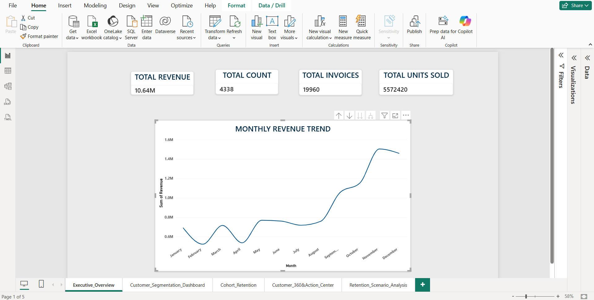
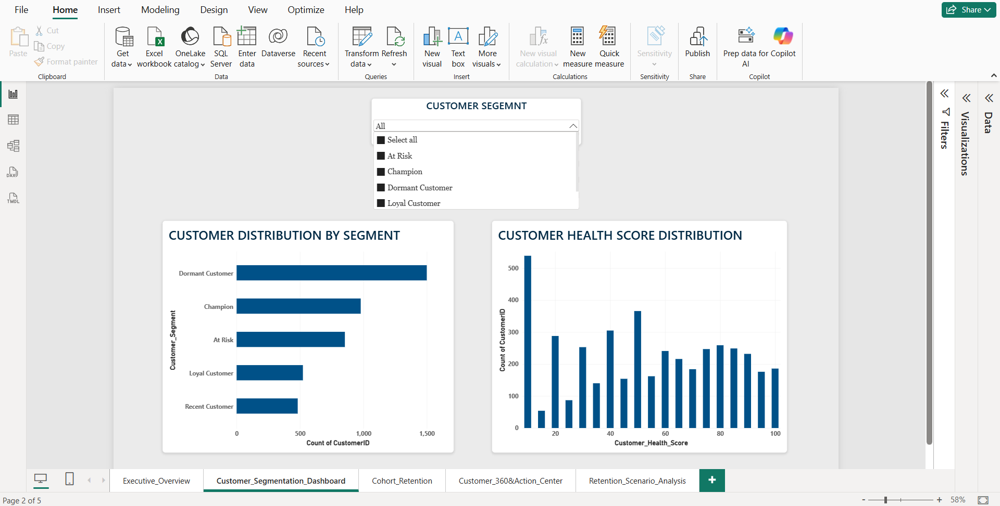
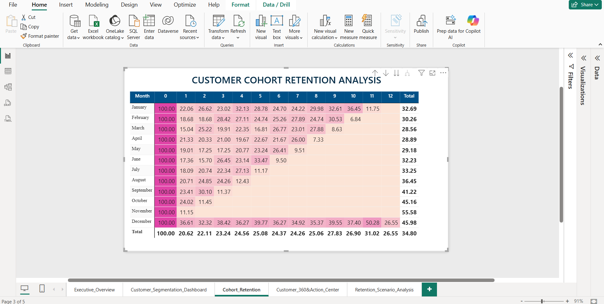
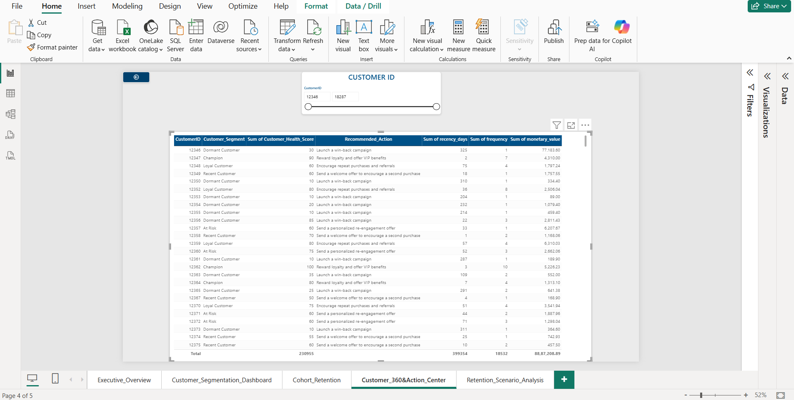
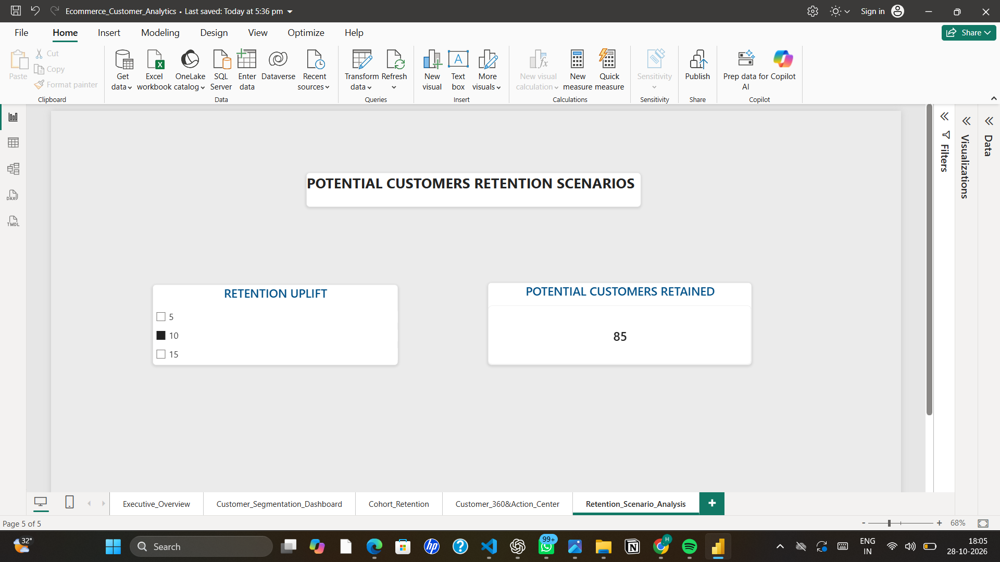

# E-commerce Customer Behaviour & Retention Analytics

An end-to-end data analytics project exploring e-commerce sales, customer purchasing behaviour, customer segmentation, and retention patterns using Python, SQL, SQLite, and Power BI.

## Project Overview

This project transforms historical online retail transaction data into business insights. It includes data cleaning, SQL-based analysis, RFM metrics, rule-based customer segmentation, cohort retention analysis, and an interactive Power BI dashboard.

## Business Objectives

* Analyze sales performance and monthly revenue trends.
* Understand customer purchasing behaviour.
* Segment customers using RFM-related metrics and business rules.
* Examine customer retention across cohorts.
* Identify at-risk and dormant customer segments.
* Explore hypothetical customer retention scenarios.

## Technology Stack

| Technology | Purpose                               |
| ---------- | ------------------------------------- |
| Python     | Data preparation and analysis         |
| Pandas     | Data manipulation                     |
| SQLite     | Database storage                      |
| SQL        | Business and customer analysis        |
| Power BI   | Interactive dashboards                |
| CSV        | Data exchange between workflow stages |

## Dataset

This project uses the UCI Online Retail dataset, which contains historical online retail transactions.

**Dataset source:** [UCI Machine Learning Repository — Online Retail](https://archive.ics.uci.edu/dataset/352/online+retail)

The original `OnlineRetail.csv` file is not included in this repository because of its size. Download it from the source above and place it inside the `dataset/` folder before running the Python scripts.

The repository contains three processed customer analysis datasets:

* `customer_rfm.csv`
* `customer_segments.csv`
* `cohort_retention.csv`

Other large intermediate CSV files and the generated SQLite database are kept locally and are not included in this repository.

## Project Structure

```text
Ecommerce_Customer_Analytics/
├── dataset/
│   ├── customer_rfm.csv
│   ├── customer_segments.csv
│   └── cohort_retention.csv
├── scripts/
│   ├── inspect_data.py
│   ├── clean_data.py
│   ├── setup_database.py
│   ├── run_sql.py
│   ├── export_rfm.py
│   ├── create_customer_segments.py
│   └── create_cohort_analysis.py
├── sql/
├── powerbi/
│   └── Ecommerce_Customer_Analytics.pbix
├── screenshots/
│   ├── 01_Executive_Overview.png
│   ├── 02_Customer_Segmentation.png
│   ├── 03_Cohort_Retention.png
│   ├── 04_Customer_360.png
│   └── 05_Retention_Scenarios.png
├── documentation/
│   └── Project_Report.md
├── .gitignore
└── README.md
```

## Dashboard Pages

### 1. Executive Overview

Provides key transaction metrics and monthly revenue trends.



### 2. Customer Segmentation

Displays customer segment distribution across Champions, Loyal Customers, Recent Customers, At Risk customers, and Dormant Customers.



### 3. Cohort Retention

Examines customer retention by first-purchase cohort and cohort age.



### 4. Customer 360 & Action Center

Provides customer-level metrics, segment classifications, health scores, and recommended actions.



### 5. Retention Scenario Analysis

Explores hypothetical retention uplift scenarios and estimates the number of potentially retained at-risk customers.



## Key Findings

* The analysis includes 4,338 identified customers.
* Customer segmentation contains 979 Champions, 523 Loyal Customers, 482 Recent Customers, 854 At Risk customers, and 1,500 Dormant Customers.
* At Risk and Dormant customers together represent approximately 54.3% of the analyzed customer base.
* November 2011 recorded the highest monthly revenue in the current analysis, at approximately 1.50 million.
* Cohort analysis provides insight into changes in repeat purchasing activity over time.

## Methodology

1. Inspected and cleaned the original transaction dataset using Python.
2. Prepared transaction-level and customer-level datasets.
3. Stored transaction data in SQLite.
4. Used SQL to analyze transaction revenue, invoices, customers, and monthly trends.
5. Calculated RFM-related customer metrics.
6. Created rule-based customer segments and recommended actions.
7. Generated cohort retention data.
8. Built interactive Power BI report pages.

## Limitations

* The dataset covers December 2010 through December 2011, with December 2011 incomplete.
* The current transaction revenue calculation includes negative-quantity return transactions.
* Customer segments and health scores are based on business rules, not a trained predictive model.
* Retention uplift scenarios are hypothetical calculations, not validated forecasts.
* The results describe historical data and should not be interpreted as current business performance.

## Documentation

See [`documentation/Project_Report.md`](documentation/Project_Report.md) for the detailed project report, dataset description, analysis process, findings, and limitations.

## Author

Developed as a data analytics portfolio project to demonstrate practical skills in Python, SQL, data preparation, customer analytics, and Power BI visualization.

